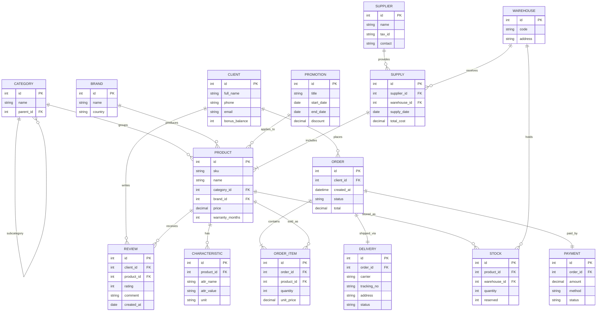

# Практична робота: Опис предметної області та вибір моделі даних

## Предметна область: **Магазин електроніки**

---

## 1. Обґрунтування вибору

Для роботи обрано предметну область **«Магазин електроніки»** — мережу роздрібної торгівлі технікою (смартфони, ноутбуки, аксесуари, побутова електроніка) з онлайн-каталогом та офлайн-точками продажу. Ця область має багаті зв'язки між об'єктами (товар — категорія — склад — замовлення — клієнт), чіткі транзакційні сценарії та різнорідні типи даних — від числових цін до текстових відгуків і технічних характеристик, що робить її зручним прикладом для порівняння моделей даних.

---

## 2. Опис предметної області

### 2.1. Користувачі системи

| Роль | Функції в системі |
|---|---|
| **Покупець (клієнт)** | Переглядає каталог, порівнює товари, додає в кошик, оформлює замовлення, залишає відгуки, відстежує доставку. |
| **Продавець-консультант** | Створює замовлення у торговій точці, оформлює повернення, консультує щодо наявності. |
| **Менеджер складу** | Веде облік залишків, приймає постачання, керує переміщеннями між складами. |
| **Контент-менеджер** | Додає нові товари, заповнює характеристики, оновлює фото та описи. |
| **Бухгалтер** | Контролює оплати, формує фінансові звіти, обробляє повернення коштів. |
| **Адміністратор системи** | Керує правами доступу, довідниками, резервним копіюванням. |

### 2.2. Об'єкти предметної області

- **Товар (модель)** — конкретна модель виробу (наприклад, *iPhone 15 Pro 256GB Titanium Blue*).
- **Категорія** — ієрархічна рубрика каталогу (Електроніка → Смартфони → Apple).
- **Бренд / виробник** — компанія-виробник.
- **Характеристика** — пара «назва — значення» (діагональ: 6.1″; акумулятор: 3274 мА·год).
- **Складський залишок** — кількість товару на конкретному складі або у магазині.
- **Склад / магазин** — фізична точка зберігання чи продажу.
- **Клієнт** — фізична або юридична особа, яка здійснює покупки.
- **Замовлення** — факт оформлення покупки.
- **Позиція замовлення** — рядок замовлення (товар, кількість, ціна).
- **Оплата** — транзакція оплати замовлення.
- **Доставка** — факт і параметри відвантаження.
- **Відгук** — оцінка та коментар клієнта до товару.
- **Акція / знижка** — правила зміни ціни.
- **Постачальник** — контрагент, від якого надходить товар.
- **Постачання** — факт приймання партії товару.

### 2.3. Операції, які має підтримувати система

- Додавання, редагування та зняття товарів з продажу.
- Пошук і фільтрація каталогу за категоріями, характеристиками, ціною, брендом.
- Оформлення замовлення (онлайн і в торговій точці).
- Резервування товару під замовлення та списання залишків.
- Обробка оплат (готівка, картка, онлайн-платіж, розстрочка).
- Керування доставкою та відстеження статусів.
- Повернення товару та кошти.
- Приймання постачань і оновлення залишків.
- Нарахування бонусів лояльності.
- Публікація та модерація відгуків.
- Формування звітів (продажі, оборот складу, ABC-аналіз).
- Розмежування прав доступу.

---

## 3. Список фактів, які потрібно зберігати

| № | Об'єкт | Факт (атрибут) | Приклад |
|---|---|---|---|
| 1 | Товар | Артикул (SKU) | `SM-A155-128-BK` |
| 2 | Товар | Назва моделі | Samsung Galaxy A15 128GB Black |
| 3 | Товар | Бренд | Samsung |
| 4 | Товар | Категорія | Смартфони |
| 5 | Товар | Ціна роздрібна | 8 499 грн |
| 6 | Товар | Гарантійний термін | 24 міс. |
| 7 | Характеристика | Назва / значення / одиниця | «Діагональ / 6.5 / дюйм» |
| 8 | Склад | Код складу | `WH-KYIV-01` |
| 9 | Склад | Адреса | м. Київ, вул. Хрещатик, 1 |
| 10 | Залишок | Кількість на складі | 14 шт. |
| 11 | Залишок | Зарезервовано | 3 шт. |
| 12 | Клієнт | ПІБ / назва компанії | Іваненко П. С. |
| 13 | Клієнт | Телефон, email | `+380…`, `mail@…` |
| 14 | Клієнт | Бонусний баланс | 320 балів |
| 15 | Замовлення | Номер | `ORD-2026-00412` |
| 16 | Замовлення | Дата й час | 2026-11-25 20:14 |
| 17 | Замовлення | Статус | «оплачено / у доставці» |
| 18 | Позиція замовлення | Товар, кількість, ціна | SM-A155-128-BK × 1, 8 499 грн |
| 19 | Оплата | Сума, спосіб, статус | 8 499 грн, картка, успішно |
| 20 | Доставка | Перевізник, ТТН, адреса | Нова пошта, `590…`, вул. Шевченка, 5 |
| 21 | Відгук | Оцінка, текст, дата | ★★★★☆, «швидка робота», 2026-11-20 |
| 22 | Акція | Період, % знижки, умови | 20–30.11, −10%, при чеку від 5000 грн |
| 23 | Постачальник | Назва, ЄДРПОУ, контакти | ТОВ «ТехноІмпорт», `12345678` |
| 24 | Постачання | Дата, товари, закупівельна ціна | 2026-11-10, партія 50 шт., 6 200 грн/шт. |

---

## 4. ER-діаграма бази даних

### Пояснення нотації Crow's Foot

| Символ | Значення |
|---|---|
| `\|\|` | рівно один (обов'язковий) |
| `\|{` | один або більше (обов'язковий) |
| `o{` | нуль або більше (необов'язковий) |
| `o\|` | нуль або один (необов'язковий) |

### Умовні позначення атрибутів

- **PK** (Primary Key) — первинний ключ, унікально ідентифікує запис.
- **FK** (Foreign Key) — зовнішній ключ, посилання на запис в іншій таблиці.

---

## 5. Таблиця «Об'єкт — Факт — Сценарій»

| Об'єкт | Факт | Сценарій «Додати новий товар у каталог» | Сценарій «Оформити замовлення клієнта» |
|---|---|---|---|
| **Товар** | SKU, назва, ціна, бренд | ✅ створюється новий запис | 📖 читається для відображення й перевірки ціни |
| **Категорія** | Належність товару | ✅ прив'язується нова позиція | 📖 читається для аналітики |
| **Характеристики** | Пари «атрибут — значення» | ✅ створюються записи характеристик | — не змінюються |
| **Склад** | Код, адреса | 📖 читається (обирається склад) | 📖 читається (визначається джерело відвантаження) |
| **Залишок** | Кількість, резерв | ✅ створюється з 0 або оновлюється після постачання | 🔄 резерв +N, після відвантаження кількість –N |
| **Клієнт** | ПІБ, контакти, бонуси | — не задіяний | ✅ створюється новий або 📖 читається існуючий; 🔄 оновлюється бонусний баланс |
| **Замовлення** | Номер, дата, статус | — | ✅ створюється новий запис, статус «новий» |
| **Позиція замовлення** | Товар, кількість, ціна | — | ✅ створюється рядок на кожен обраний товар |
| **Оплата** | Сума, спосіб, статус | — | ✅ створюється запис після підтвердження оплати |
| **Доставка** | Перевізник, ТТН, адреса | — | ✅ створюється запис, 🔄 оновлюється статус у процесі |
| **Акція** | Правила, період | 📖 перевіряється застосування до нового товару | 📖 застосовується для розрахунку кінцевої ціни |
| **Відгук** | Оцінка, текст | — | — (створюється після отримання товару) |

**Умовні позначення:** ✅ створюється · 🔄 змінюється · 📖 читається

---

## 6. Порівняння моделей даних

### 6.1. Ієрархічна модель

- **Сильна сторона:** добре відображає жорстку ієрархію *Категорія → Підкатегорія → Товар*, швидкий пошук «згори вниз» по каталогу.
- **Слабка сторона:** товар реально належить кільком класифікаціям (наприклад, «Apple» та «Смартфони з NFC»), а ієрархія допускає тільки одного батька — виникає дублювання або штучні обхідні шляхи.

### 6.2. Мережева модель

- **Сильна сторона:** природно описує зв'язки «багато-до-багатьох»: один товар — у багатьох акціях, одне замовлення — від одного клієнта, але в різні склади.
- **Слабка сторона:** складна навігація через вказівники між записами; зміна структури (наприклад, додавання нового типу зв'язку «товар — сумісний аксесуар») вимагає переробки схеми й програмного коду.

### 6.3. Реляційна модель

- **Сильна сторона:** надійні транзакції з гарантіями **ACID** критичні для оплат і списання залишків; декларативна мова **SQL** дає потужні аналітичні звіти (продажі за період, топ-категорії, оборотність).
- **Слабка сторона:** довільний набір характеристик у різних категоріях товарів (у смартфона — діагональ і акумулятор, у ноутбука — процесор і ОЗП) погано лягає на фіксовану схему таблиць, вимагає EAV-структур або окремих таблиць.

### 6.4. Об'єктна модель

- **Сильна сторона:** дає змогу описати ієрархію класів *Товар → Смартфон → iPhone* з успадкуванням атрибутів і методів (`розрахуватиЗнижку()`), що зручно для бізнес-логіки.
- **Слабка сторона:** мало поширених промислових СКБД, слабка підтримка складних аналітичних запитів і звітів; складно інтегрувати з BI-системами.

### 6.5. Документна модель (NoSQL)

- **Сильна сторона:** картка товару зі складною й різною для категорій структурою характеристик, фото, відгуків природно зберігається як єдиний JSON-документ; легко горизонтально масштабувати каталог.
- **Слабка сторона:** слабші гарантії цілісності при транзакціях (оплата, резервування залишку на кількох складах); дублювання даних (ціна товару в позиції замовлення, бренд у кожному товарі) ускладнює оновлення.

### 6.6. Модель «ключ — значення»

- **Сильна сторона:** надзвичайно швидкий доступ для сесій, кошиків користувачів, кешу залишків і популярних карток товару — відгук у мілісекундах.
- **Слабка сторона:** немає структури запитів і зв'язків — неможливо виконати запит типу «всі замовлення клієнта за місяць» без повного перебору; не підходить як основне сховище.

---

## 7. Обґрунтування вибору моделі даних

**Обрана модель: реляційна** (як основне сховище) з опціональним **документним** доповненням для каталогу товарів і **ключ-значення** кешем для сесій і кошика.

**Чому реляційна:**

- Основні бізнес-процеси магазину — **транзакційні**: оформлення замовлення, оплата, резервування залишку, повернення коштів. Вони вимагають суворих гарантій **ACID**, щоб гроші клієнта та кількість товару на складі завжди залишалися коректними — це найкраще забезпечує реляційна СКБД (PostgreSQL, MySQL, MS SQL Server).
- Між об'єктами є чіткі зв'язки «один-до-багатьох» та «багато-до-багатьох» (замовлення ↔ позиції ↔ товари ↔ склади), які природно описуються таблицями з первинними та зовнішніми ключами.
- Потрібна **аналітика**: звіти про продажі, ABC-аналіз, оборотність складу. SQL дає декларативні агрегатні запити й інтегрується з BI-інструментами.
- Реляційна модель забезпечує **цілісність даних** (не можна продати товар, якого немає на складі; не можна створити замовлення без клієнта).

**Чому інші варіанти гірші:**

- *Ієрархічна й мережева* — застарілі, негнучкі до змін схеми й не підтримуються сучасними популярними СКБД.
- *Об'єктна* — має вузьку екосистему інструментів і слабку аналітику.
- *Чисто документна* — не гарантує узгодженості фінансових транзакцій; дублювання даних ускладнює оновлення цін і характеристик.
- *Чисто «ключ — значення»* — не підтримує складні запити, тому не може бути основним сховищем, але корисна як допоміжний шар для швидкого доступу.

**Висновок:** оптимальний варіант — **гібридна архітектура з реляційною СКБД у ядрі**, яка забезпечує надійність транзакцій і аналітики, доповнена NoSQL-сховищами для спеціалізованих задач (гнучкі характеристики товарів, кеш, сесії).

---

## 8. Відповіді на питання для захисту

**1. Чим дані відрізняються від інформації та знань?**

- **Дані** — «сирі» факти без контексту: числа *8499, 14, 2026-11-25*.
- **Інформація** — опрацьовані дані з контекстом: *«Товар SM-A155-128-BK коштує 8499 грн, на складі KYIV-01 — 14 шт.»*.
- **Знання** — узагальнені закономірності й правила для рішень: *«Товари з оборотністю менше 2 разів на місяць слід виводити з асортименту»*.

**2. Які функції СКБД знадобляться для обраної системи?**

- **Керування одночасним доступом** — кілька касирів і онлайн-клієнти одночасно працюють з тим самим залишком.
- **Забезпечення цілісності даних** — не можна оформити замовлення на неіснуючий товар або з від'ємною кількістю.
- **Транзакції (ACID)** — оплата й списання залишку виконуються атомарно.
- **Резервне копіювання й відновлення** — захист від втрати даних про продажі.
- **Розмежування прав доступу** — продавець не бачить бухгалтерських звітів.
- **Оптимізація запитів та індексація** — швидкий пошук у каталозі з мільйонами позицій.
- **Журналювання (аудит)** — хто і коли змінив ціну, оформив повернення.

**3. Чому один і той самий факт може бути збережено з помилкою за кількома адресами?**

Через **надлишковість (дублювання)** даних. Наприклад, бренд «Samsung» може зберігатися в кожному записі товару як текст. Якщо в одному запису напишуть «Samsung», в іншому «samsung», а в третьому «Самсунґ» — система сприйматиме це як три різні бренди. Такі помилки виникають, коли факт не винесено в окрему довідкову таблицю (нормалізацію порушено). Інший приклад — ціна товару, збережена і в картці товару, і в позиції замовлення: при зміні ціни її потрібно оновлювати в обох місцях, і легко забути одне з них.

**4. Які критерії використали для вибору моделі даних?**

- **Характер операцій** (транзакційні vs аналітичні) — переважають транзакційні, тому обрано реляційну.
- **Структура зв'язків між об'єктами** — складні «багато-до-багатьох» вимагають реляційної або мережевої моделі.
- **Вимоги до цілісності та ACID** — критичні для грошових операцій.
- **Передбачуваність схеми** — основні об'єкти (замовлення, клієнти, оплати) добре структуровані.
- **Потреба в аналітиці й звітності** — SQL є стандартом.
- **Масштабованість і продуктивність** — реляційні СКБД добре працюють у типових обсягах роздрібної мережі; для пікових навантажень додано кеш.
- **Зрілість екосистеми й доступність фахівців** — реляційні СКБД найпоширеніші на ринку праці.
