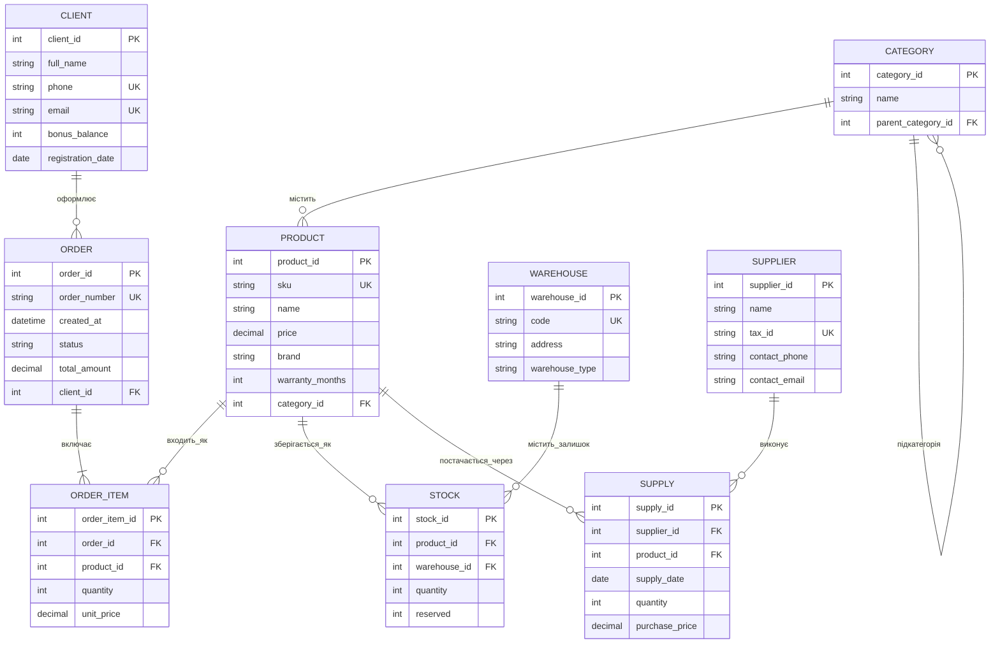

# Практична робота №2: Побудова концептуальної ER-моделі

## Предметна область: Магазин електроніки

> Продовження роботи №1. Беремо описану раніше предметну область «Магазин електроніки» та виділяємо з неї сутності, атрибути й зв'язки для побудови концептуальної ER-моделі.

---

## 1. Виділення іменників і дієслів з опису вимог

### 1.1. Іменники (кандидати у сутності й атрибути)

Зі словесного опису системи виокремлено такі іменники:

> *клієнт, покупець, продавець, менеджер, товар, модель, артикул, SKU, назва, ціна, бренд, виробник, категорія, рубрика, характеристика, діагональ, акумулятор, склад, магазин, адреса, залишок, кількість, замовлення, номер, дата, статус, позиція, оплата, сума, спосіб, доставка, перевізник, ТТН, відгук, оцінка, коментар, акція, знижка, постачальник, постачання, партія, гарантія, бонус*

### 1.2. Дієслова (кандидати у зв'язки)

> *оформлювати, купувати, продавати, доставляти, оплачувати, повертати, зберігати, постачати, приймати, резервувати, списувати, додавати, нараховувати, залишати (відгук), шукати, переглядати, належати, містити*

### 1.3. Розподіл слів за ролями

| Категорія | Слова |
|---|---|
| **Сутності** (самостійні об'єкти з життєвим циклом) | клієнт, товар, замовлення, категорія, склад, постачальник |
| **Атрибути** (властивості сутностей) | ПІБ, телефон, email, SKU, назва, ціна, бренд, гарантія, адреса, номер, дата, статус, сума, бонус |
| **Зв'язки** (дії між сутностями) | оформлює (клієнт → замовлення), містить (замовлення → товар), належить (товар → категорія), зберігається (товар → склад), постачає (постачальник → товар) |
| **Відсіяні слова** (ролі користувачів, які не є сутностями даних) | покупець, продавець, менеджер — ролі у системі, а не сутності бази даних |

### 1.4. Правило відбору

Об'єкт стає **сутністю**, якщо він:

- має власний унікальний ідентифікатор;
- існує самостійно (не є властивістю чогось іншого);
- може брати участь у кількох зв'язках;
- має життєвий цикл (створюється, змінюється, видаляється).

Якщо об'єкт — лише властивість (наприклад, «ціна», «телефон») — це атрибут. Якщо дія між двома об'єктами — зв'язок.

---

## 2. Словник даних (сутності, атрибути, домени, ключі)

Обрано **6 сутностей**. Для кожної вказано атрибути, домени (типи даних) та кандидатні ключі.

### 2.1. CLIENT — Клієнт

| Атрибут | Домен (тип) | Обмеження / приклад | Ключ |
|---|---|---|---|
| `client_id` | INTEGER | > 0, автоінкремент | **PK** |
| `full_name` | VARCHAR(100) | не NULL | |
| `phone` | VARCHAR(20) | формат +380XXXXXXXXX | candidate key (UNIQUE) |
| `email` | VARCHAR(100) | формат user@domain | candidate key (UNIQUE) |
| `bonus_balance` | INTEGER | ≥ 0, за замовчуванням 0 | |
| `registration_date` | DATE | не пізніше сьогоднішньої дати | |

**Кандидатні ключі:** `client_id`, `phone`, `email`.
**Первинний ключ:** `client_id` (сурогатний, не несе бізнес-значення).

### 2.2. PRODUCT — Товар

| Атрибут | Домен (тип) | Обмеження / приклад | Ключ |
|---|---|---|---|
| `product_id` | INTEGER | > 0 | **PK** |
| `sku` | VARCHAR(50) | унікальний артикул, напр. `SM-A155-128-BK` | candidate key (UNIQUE) |
| `name` | VARCHAR(200) | не NULL | |
| `price` | DECIMAL(10,2) | > 0, грн | |
| `brand` | VARCHAR(50) | напр. Samsung | |
| `warranty_months` | INTEGER | ≥ 0, за замовчуванням 12 | |
| `category_id` | INTEGER | FK → CATEGORY | |

**Кандидатні ключі:** `product_id`, `sku`.

### 2.3. CATEGORY — Категорія

| Атрибут | Домен (тип) | Обмеження / приклад | Ключ |
|---|---|---|---|
| `category_id` | INTEGER | > 0 | **PK** |
| `name` | VARCHAR(100) | «Смартфони», «Ноутбуки» | candidate key (UNIQUE у межах `parent_id`) |
| `parent_category_id` | INTEGER | NULL для кореневої | FK → CATEGORY |

Самопосилальний зв'язок дозволяє будувати ієрархію: *Електроніка → Смартфони → Apple*.

### 2.4. ORDER — Замовлення

| Атрибут | Домен (тип) | Обмеження / приклад | Ключ |
|---|---|---|---|
| `order_id` | INTEGER | > 0 | **PK** |
| `order_number` | VARCHAR(20) | напр. `ORD-2026-00412` | candidate key (UNIQUE) |
| `created_at` | DATETIME | не пізніше поточного часу | |
| `status` | ENUM | `новий` / `оплачено` / `доставляється` / `завершено` / `скасовано` | |
| `total_amount` | DECIMAL(10,2) | ≥ 0 | |
| `client_id` | INTEGER | не NULL | FK → CLIENT |

### 2.5. WAREHOUSE — Склад / магазин

| Атрибут | Домен (тип) | Обмеження / приклад | Ключ |
|---|---|---|---|
| `warehouse_id` | INTEGER | > 0 | **PK** |
| `code` | VARCHAR(20) | напр. `WH-KYIV-01` | candidate key (UNIQUE) |
| `address` | VARCHAR(200) | не NULL | |
| `warehouse_type` | ENUM | `склад` / `магазин` | |

### 2.6. SUPPLIER — Постачальник

| Атрибут | Домен (тип) | Обмеження / приклад | Ключ |
|---|---|---|---|
| `supplier_id` | INTEGER | > 0 | **PK** |
| `name` | VARCHAR(100) | «ТОВ ТехноІмпорт» | |
| `tax_id` | VARCHAR(20) | ЄДРПОУ, 8 цифр | candidate key (UNIQUE) |
| `contact_phone` | VARCHAR(20) | | |
| `contact_email` | VARCHAR(100) | | |

---

## 3. Таблиця зв'язків

| № | Зв'язок | Сутності | Ступінь | Кардинальність | Обов'язковість (учас­ть) |
|---|---|---|---|---|---|
| R1 | *оформлює* | CLIENT — ORDER | **1 : N** | один клієнт → 0..N замовлень | CLIENT — часткова; ORDER — повна (замовлення без клієнта не існує) |
| R2 | *належить* | PRODUCT — CATEGORY | **N : 1** | категорія → 0..N товарів; товар → рівно 1 категорія | CATEGORY — часткова; PRODUCT — повна |
| R3 | *підкатегорія* (ієрархія) | CATEGORY — CATEGORY | **1 : N** (рекурсія) | батьківська → 0..N дочірніх | обидві часткові (корінь без батька) |
| R4 | *містить* | ORDER — PRODUCT | **M : N** | замовлення → 1..N товарів; товар → 0..N замовлень | ORDER — повна (не може бути порожнім); PRODUCT — часткова |
| R5 | *зберігається на* | PRODUCT — WAREHOUSE | **M : N** | товар → 0..N складів; склад → 0..N товарів | обидві часткові |
| R6 | *постачає* | SUPPLIER — PRODUCT | **M : N** | постачальник → 0..N товарів; товар → 0..N постачальників | обидві часткові |

**Умовні позначення:**
- *Ступінь* — число сутностей у зв'язку (унарний / бінарний / тернарний).
- *Кардинальність* — скільки екземплярів однієї сутності може бути пов'язано з іншою (1:1, 1:N, M:N).
- *Обов'язковість* (повна / часткова) — чи обов'язково кожен екземпляр сутності бере участь у зв'язку.

---

## 4. Зв'язки M:N — проміжні сутності

У реляційній моделі зв'язок **багато-до-багатьох** не можна реалізувати напряму — потрібна **асоціативна (проміжна) сутність**, яка розкладає його на два зв'язки **1:N**.

### 4.1. R4: ORDER ↔ PRODUCT → `ORDER_ITEM` (позиція замовлення)

Одне замовлення містить багато товарів, один товар входить до багатьох замовлень. Крім зв'язку, потрібно зберігати власні атрибути **кожної позиції**:

| Атрибут | Домен |
|---|---|
| `order_item_id` | INTEGER, PK |
| `order_id` | FK → ORDER |
| `product_id` | FK → PRODUCT |
| `quantity` | INTEGER > 0 |
| `unit_price` | DECIMAL(10,2) |

Отже, зв'язок M:N розкладається на: **ORDER ⟶ 1:N ⟵ ORDER_ITEM ⟶ N:1 ⟵ PRODUCT**.

### 4.2. R5: PRODUCT ↔ WAREHOUSE → `STOCK` (залишок)

Один товар лежить на багатьох складах, на одному складі — багато товарів. Для кожної пари (товар, склад) потрібно зберігати кількість.

| Атрибут | Домен |
|---|---|
| `stock_id` | INTEGER, PK |
| `product_id` | FK → PRODUCT |
| `warehouse_id` | FK → WAREHOUSE |
| `quantity` | INTEGER ≥ 0 |
| `reserved` | INTEGER ≥ 0 |

### 4.3. R6: SUPPLIER ↔ PRODUCT → `SUPPLY` (постачання)

Один постачальник постачає багато товарів, один товар може приходити від кількох постачальників. Для кожного постачання потрібно зберігати дату, партію й закупівельну ціну.

| Атрибут | Домен |
|---|---|
| `supply_id` | INTEGER, PK |
| `supplier_id` | FK → SUPPLIER |
| `product_id` | FK → PRODUCT |
| `supply_date` | DATE |
| `quantity` | INTEGER > 0 |
| `purchase_price` | DECIMAL(10,2) |

---

## 5. ER-діаграма (нотація Crow's Foot)

Нижче — діаграма у вигляді коду Mermaid. GitHub, GitLab, Obsidian та VS Code рендерять її автоматично.



### Нотація Crow's Foot — пояснення символів

| Символ | Значення |
|---|---|
| `\|\|` | рівно один (обов'язковий) |
| `\|{` | один або більше (обов'язковий) |
| `o{` | нуль або більше (необов'язковий) |
| `o\|` | нуль або один (необов'язковий) |

### Експорт діаграми в PNG/SVG

1. Скопіювати блок між ` ```mermaid ... ``` `.
2. Відкрити [mermaid.live](https://mermaid.live) → вставити код.
3. **Actions → PNG / SVG** — завантажити зображення й додати до звіту поряд з цим файлом.

---

## 6. Пояснення одного M:N зв'язку

### Зв'язок «Замовлення ↔ Товар» (R4)

**Опис.** У магазині електроніки одне замовлення клієнта може містити багато різних товарів (наприклад, смартфон + чохол + захисне скло), а один і той самий товар (наприклад, iPhone 15) продається у багатьох замовленнях різним покупцям. Це класичний M:N-зв'язок.

**Чому пряма реалізація неможлива?** У реляційній моделі кожна комірка таблиці зберігає **атомарне значення**. Якщо спробувати в таблиці `ORDER` створити колонку `product_ids`, яка містить список товарів, це порушить **першу нормальну форму** (1NF) і зламає SQL-запити типу «знайти всі замовлення з iPhone».

**Розв'язання — проміжна (асоціативна) сутність `ORDER_ITEM`.** Ми вводимо нову таблицю-посередник, яка:

- має власний первинний ключ `order_item_id`;
- містить **два зовнішні ключі** — на `ORDER` і на `PRODUCT`;
- зберігає **власні атрибути** цього конкретного рядка: кількість куплених одиниць (`quantity`) і ціну на момент продажу (`unit_price`).

**Що ми отримуємо:**

1. **Два прості зв'язки 1:N замість одного M:N** — ORDER → ORDER_ITEM ← PRODUCT.
2. **Можливість зберігати історію цін.** Якщо завтра ціна товару зміниться, у старому замовленні залишиться та сума, за якою клієнт реально купив.
3. **Детальну аналітику** — можна рахувати середню кількість товарів у чеку, топ-продажі за періодом, маржу тощо.
4. **Цілісність даних** — зовнішні ключі не дають створити позицію з неіснуючим товаром або замовленням.

**Приклад запису:** замовлення `ORD-2026-00412` клієнта Іваненка містить дві позиції:
- `(order_item_id=1, order_id=412, product_id=7, quantity=1, unit_price=8499.00)` — смартфон;
- `(order_item_id=2, order_id=412, product_id=23, quantity=2, unit_price=199.00)` — два чохли.

---

## 7. Відповіді на питання для захисту

### 7.1. Як відрізнити атрибут від сутності?

Атрибут **описує властивість** іншого об'єкта й не має сенсу окремо. Сутність **існує самостійно** й має власний ідентифікатор. Практичний тест:

- Чи потрібно зберігати більше одного факту про цей об'єкт? Якщо так — це сутність.
- Чи може цей об'єкт брати участь у кількох зв'язках з іншими об'єктами? Якщо так — сутність.
- Чи має він життєвий цикл (створюється, змінюється, видаляється)? Якщо так — сутність.

**Приклад:** «бренд» спочатку виглядає як атрибут товару (`brand = "Samsung"`). Але якщо ми хочемо зберігати країну бренду, його логотип, представника й зв'язати бренд з гарантійними умовами — він стає окремою сутністю `BRAND`, а в товарі залишається лише `brand_id`.

### 7.2. Що означає кардинальність 0..N?

Запис `0..N` означає, що з одного екземпляра сутності може бути пов'язано **від нуля до будь-якої кількості** екземплярів іншої сутності. Це поєднання двох характеристик:

- **нижня межа 0** — участь необов'язкова (мінімальна кардинальність = 0);
- **верхня межа N** — обмеження зверху немає (максимальна кардинальність = many).

**Приклад:** клієнт може мати 0..N замовлень — щойно зареєстрований клієнт має нуль замовлень, постійний покупець може мати сотні. Зв'язок існує, але клієнт може існувати й без жодного замовлення.

### 7.3. Чому зв'язок M:N потребує окремого рішення?

У реляційній моделі рядок таблиці зберігає атомарні значення, а зв'язки реалізуються через зовнішні ключі. **Прямий M:N реалізувати неможливо**, тому що:

- Не можна в одній комірці зберегти список ідентифікаторів (порушить 1NF).
- Не можна додати багато колонок `product_id_1, product_id_2, ...` — кількість товарів у замовленні заздалегідь невідома.
- Не можна покласти FK на обидві сторони — тоді таблиці посилатимуться одна на одну циклічно і без однозначної відповідності.

**Рішення:** вводять **асоціативну сутність** (join table), яка розкладає M:N на два зв'язки 1:N. Ця таблиця-посередник також дозволяє зберігати атрибути самого зв'язку (кількість, ціну, дату, статус).

### 7.4. Чим нотація Чена відрізняється від Crow's Foot?

| Критерій | Нотація **Чена** (1976) | Нотація **Crow's Foot** |
|---|---|---|
| Сутності | **Прямокутники** з назвою | Прямокутники з назвою та списком атрибутів |
| Атрибути | **Овали**, з'єднані лініями із сутністю | Усередині блоку сутності, як рядки |
| Зв'язки | **Ромб** на лінії між сутностями | Лінія з символами на кінцях |
| Кардинальність | Цифри **1, M, N** біля ліній | Графічні символи: `\|`, `o`, «ніжка ворони» |
| Візуальна складність | Громіздка, багато окремих фігур | Компактна, добре читається |
| Де використовується | Академічне середовище, підручники | Промислова розробка, інструменти (ERwin, dbdiagram, Mermaid) |

**Коротко:** Чен — теоретична, детальна й зручна для пояснення концепцій; Crow's Foot — практична, компактна, стандарт індустрії.

---

## Висновок

У межах роботи виділено **6 основних сутностей** (CLIENT, PRODUCT, CATEGORY, ORDER, WAREHOUSE, SUPPLIER), визначено 6 зв'язків, з яких **3 — типу M:N**, і розв'язано через проміжні сутності `ORDER_ITEM`, `STOCK`, `SUPPLY`. Побудована концептуальна модель готова до переведення у логічну реляційну схему з подальшим створенням таблиць за допомогою SQL.
