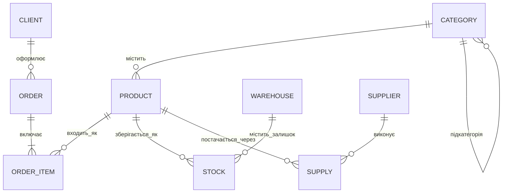

# Практична робота №3: Концептуальна ER-модель у CASE-засобі

## Предметна область: Магазин електроніки

> Продовження робіт №1 і №2. Переносимо побудовану концептуальну модель у CASE-середовище, перевіряємо її сценаріями та фіксуємо припущення й відкриті питання.

---

## 1. Вибір CASE-засобу

Для побудови моделі обрано **[dbdiagram.io](https://dbdiagram.io)** — безкоштовне веб-середовище для концептуального й логічного проєктування баз даних.

### Чому саме dbdiagram.io

| Критерій | Переваги |
|---|---|
| **Доступність** | Онлайн, без встановлення; працює з будь-якого браузера. |
| **Нотація** | Власна мова **DBML** (Database Markup Language) — текстова, легко читається, добре версіонується у git. |
| **Візуалізація** | Автоматична побудова діаграми у стилі Crow's Foot з можливістю ручного розміщення. |
| **Експорт** | PNG, PDF, SVG, а також генерація **готового SQL-скрипта** (PostgreSQL, MySQL, MS SQL Server, Oracle). |
| **Спільна робота** | Обмін посиланням, вбудовування в документацію. |

### Альтернативи, які розглядали

- **Lucidchart / draw.io** — зручні для візуальної роботи мишею, але не генерують SQL.
- **MySQL Workbench / DBeaver** — потужні, але орієнтовані вже на логічну модель.
- **ERwin Data Modeler** — промисловий стандарт, але платний.
- **Mermaid** — зручний для вбудовування в Markdown, але має обмежений редактор.

У цьому звіті як **основний результат** використано DBML-код для dbdiagram.io, а як **додатково** наведено Mermaid-версію для перегляду прямо на GitHub.

---

## 2. Межі системи

### 2.1. Процеси, які підтримує система

| Процес | Короткий опис |
|---|---|
| **Керування каталогом** | Додавання, редагування, зняття з продажу товарів; структурування за категоріями. |
| **Складський облік** | Облік залишків на складах і в магазинах; резервування під замовлення; приймання постачань. |
| **Обслуговування клієнтів** | Реєстрація клієнтів, ведення контактних даних і бонусного балансу. |
| **Оформлення продажів** | Створення замовлень, формування позицій, розрахунок суми, обробка статусів. |
| **Облік постачань** | Фіксація партій товарів від постачальників, закупівельних цін. |

### 2.2. Запитання, на які система повинна відповідати

- Скільки одиниць конкретного товару є на кожному складі зараз?
- Які замовлення оформив клієнт за останні 30 днів?
- Яка загальна виручка магазину за місяць / квартал / рік?
- Які товари входять до конкретного замовлення та за якою ціною їх продано?
- Які товари постачає конкретний постачальник і за якою закупівельною ціною?
- Які категорії товарів найприбутковіші?
- Хто з клієнтів належить до топ-10 за обсягом покупок?
- Скільки бонусів нараховано конкретному клієнту?

### 2.3. Що НЕ входить до меж системи (out of scope)

- Бухгалтерський облік (ПДВ, податкові накладні, баланс) — ведеться в окремій системі (1С, BAS).
- Маркетингові розсилки й сегментація клієнтів — зовнішній CRM.
- Інтеграція з платіжними системами (LiqPay, WayForPay) — через API, деталі транзакцій зберігаються в системі-посереднику.
- Логістика перевізників (Нова Пошта, Укрпошта) — зберігається тільки номер ТТН і статус, деталі — у перевізника.
- Облік персоналу й зарплат — зовнішня HR-система.

---

## 3. Концептуальна модель у CASE-засобі (DBML)

Код нижче можна скопіювати у [dbdiagram.io](https://dbdiagram.io) → лівий редактор, і діаграма збудується автоматично.

```dbml
// ================================================
// Магазин електроніки — концептуальна ER-модель
// Author: Student
// CASE tool: dbdiagram.io (DBML)
// ================================================

Project electronics_store {
  database_type: 'PostgreSQL'
  Note: 'Концептуальна модель предметної області "Магазин електроніки"'
}

// ----------- Основні сутності -----------

Table client as C {
  client_id          int           [pk, increment]
  full_name          varchar(100)  [not null]
  phone              varchar(20)   [unique, note: 'формат +380XXXXXXXXX']
  email              varchar(100)  [unique]
  bonus_balance      int           [default: 0, note: '≥ 0']
  registration_date  date          [not null]
  Note: 'Фізична або юридична особа, що здійснює покупки'
}

Table category as CAT {
  category_id         int           [pk, increment]
  name                varchar(100)  [not null]
  parent_category_id  int           [ref: > CAT.category_id, note: 'NULL для кореневої']
  Note: 'Ієрархічна рубрика каталогу'
}

Table product as P {
  product_id       int            [pk, increment]
  sku              varchar(50)    [unique, not null]
  name             varchar(200)   [not null]
  price            decimal(10,2)  [not null, note: '> 0']
  brand            varchar(50)
  warranty_months  int            [default: 12]
  category_id      int            [ref: > CAT.category_id, not null]
  Note: 'Модель товару з каталогу'
}

Table warehouse as W {
  warehouse_id    int            [pk, increment]
  code            varchar(20)    [unique, not null]
  address         varchar(200)   [not null]
  warehouse_type  varchar(20)    [note: "склад | магазин"]
  Note: 'Фізична точка зберігання або продажу'
}

Table supplier as S {
  supplier_id    int            [pk, increment]
  name           varchar(100)   [not null]
  tax_id         varchar(20)    [unique, note: 'ЄДРПОУ, 8 цифр']
  contact_phone  varchar(20)
  contact_email  varchar(100)
  Note: 'Контрагент-постачальник'
}

Table "order" as O {
  order_id      int            [pk, increment]
  order_number  varchar(20)    [unique, not null]
  created_at    datetime       [not null]
  status        varchar(20)    [not null, note: "новий | оплачено | доставляється | завершено | скасовано"]
  total_amount  decimal(10,2)  [default: 0]
  client_id     int            [ref: > C.client_id, not null]
  Note: 'Замовлення клієнта'
}

// ----------- Асоціативні (M:N) сутності -----------

Table order_item as OI {
  order_item_id  int            [pk, increment]
  order_id       int            [ref: > O.order_id, not null]
  product_id     int            [ref: > P.product_id, not null]
  quantity       int            [not null, note: '> 0']
  unit_price     decimal(10,2)  [not null, note: 'ціна на момент продажу']

  Indexes {
    (order_id, product_id) [unique]
  }
  Note: 'Позиція замовлення — розв'язання M:N між ORDER і PRODUCT'
}

Table stock as ST {
  stock_id      int   [pk, increment]
  product_id    int   [ref: > P.product_id, not null]
  warehouse_id  int   [ref: > W.warehouse_id, not null]
  quantity      int   [default: 0, note: '≥ 0']
  reserved      int   [default: 0, note: '≥ 0, зарезервовано під замовлення']

  Indexes {
    (product_id, warehouse_id) [unique]
  }
  Note: 'Складський залишок — розв'язання M:N між PRODUCT і WAREHOUSE'
}

Table supply as SU {
  supply_id       int            [pk, increment]
  supplier_id     int            [ref: > S.supplier_id, not null]
  product_id      int            [ref: > P.product_id, not null]
  supply_date     date           [not null]
  quantity        int            [not null, note: '> 0']
  purchase_price  decimal(10,2)  [not null]
  Note: 'Факт постачання партії — розв'язання M:N між SUPPLIER і PRODUCT'
}
```

### 3.1. Mermaid-рендер діаграми (для GitHub-перегляду)



### 3.2. Експорт діаграми

Із [dbdiagram.io](https://dbdiagram.io):

1. **Export → PNG** — растрове зображення для вставлення у звіт.
2. **Export → PDF** — векторний звіт на одній сторінці.
3. **Export → SQL (PostgreSQL)** — готовий скрипт `CREATE TABLE ...` для створення схеми бази даних.

Файл проєкту зберігається в особистому акаунті dbdiagram.io; посилання на нього також можна додати до звіту.

---

## 4. Перевірка моделі сценаріями

Нижче — перевірка здатності моделі підтримати типові життєві сценарії магазину.

| № | Сценарій | Які таблиці змінюються | Підтримує? | Коментар |
|---|---|---|---|---|
| S1 | **Додати новий товар у каталог без залишків** | INSERT у `product` | ✅ так | `STOCK` не обов'язковий — товар може існувати без залишків. |
| S2 | **Зареєструвати нового клієнта без покупок** | INSERT у `client` | ✅ так | Зв'язок CLIENT→ORDER необов'язковий, клієнт може існувати без замовлень. |
| S3 | **Оформити замовлення з двома товарами** | INSERT у `order`, 2× INSERT у `order_item`, UPDATE `stock.reserved` | ✅ так | Через `order_item` реалізовано M:N. |
| S4 | **Оновити ціну товару** | UPDATE `product.price` | ✅ так | Історія цін збережена в `order_item.unit_price` — старі замовлення не змінюються. |
| S5 | **Прийняти постачання 50 шт. товару від постачальника** | INSERT у `supply`, UPDATE `stock.quantity` += 50 | ✅ так | Факт постачання і залишок зберігаються окремо. |
| S6 | **Переміщення товару з одного складу на інший** | UPDATE двох записів `stock` | ⚠️ частково | Факт переміщення не зберігається — лише результат. Треба додати сутність `STOCK_TRANSFER`. |
| S7 | **Скасування замовлення** | UPDATE `order.status = 'скасовано'`, UPDATE `stock.reserved` -= N | ✅ так | Залишки звільняються, історія лишається. |
| S8 | **Видалення клієнта, у якого є замовлення** | DELETE `client` | ❌ не можна | Порушить зовнішній ключ `order.client_id`. Потрібна логічна анонімізація (soft delete) або CASCADE-правило. |
| S9 | **Переведення категорії в підкатегорію іншої** | UPDATE `category.parent_category_id` | ✅ так | Самопосилальний зв'язок дозволяє реорганізацію. |
| S10 | **Один товар належить кільком категоріям** (напр. «Apple» + «Смартфони з NFC») | — | ❌ не підтримується | Поточна модель дозволяє рівно одну категорію на товар. Треба перетворити зв'язок CATEGORY↔PRODUCT на M:N через `product_category`. |
| S11 | **Продаж товару, якого немає на складі** | INSERT у `order_item` | ⚠️ не блокується моделлю | Потрібне правило БД (trigger/constraint) або бізнес-логіка застосунку, що перевіряє `stock.quantity - stock.reserved ≥ quantity`. |
| S12 | **Клієнт лишає відгук про товар** | — | ❌ не підтримується | Сутність `REVIEW` на цьому етапі винесено за межі моделі. Якщо потрібно — додати. |

**Підсумок перевірки:**

- ✅ Підтримуються повністю: 7 сценаріїв.
- ⚠️ Підтримуються частково (потрібні доповнення поза моделлю): 2 сценарії.
- ❌ Не підтримуються без доопрацювання моделі: 3 сценарії.

---

## 5. Припущення, ухвалені при побудові моделі

| № | Припущення | Обґрунтування |
|---|---|---|
| A1 | Один товар належить **рівно одній** категорії. | Спрощує каталог; відповідає більшості реальних магазинів. |
| A2 | Відгуки, рейтинги, фото винесено **поза межі** цієї моделі. | Фокус поточної роботи — транзакційне ядро. |
| A3 | Ціна товару зберігається в картці + фіксується у момент продажу у `order_item.unit_price`. | Дозволяє бачити історичну ціну без складного версіонування. |
| A4 | Одне замовлення має **один статус** на будь-який момент часу (не зберігаємо історію переходів). | Якщо потрібен аудит, додати таблицю `order_status_history`. |
| A5 | Доставка й оплата моделюються **одним записом** на замовлення, не кілька платежів / часткова доставка. | Для v1 достатньо; розширювати за потреби. |
| A6 | Клієнта **не можна фізично видаляти**, якщо є замовлення. | Фінансова звітність вимагає збереження даних. Для «забути» — soft delete або анонімізація. |
| A7 | Акції, промокоди й знижки винесено поза модель. | Складна окрема підсистема, не входить у поточні вимоги. |
| A8 | Характеристики товару (діагональ, акумулятор) не зберігаються структуровано в цій ітерації. | Для EAV- або JSON-моделі потрібен окремий крок. |
| A9 | Склад і магазин розрізняються тільки полем `warehouse_type`, спільна таблиця. | Різниця невелика; при розвитку бізнесу — розділити на дві сутності зі спільним інтерфейсом. |
| A10 | Валюта — одна (гривня). Багатовалютність поза межами. | Магазин працює в одній країні. |

---

## 6. Відкриті питання до власника вимог

Питання, які потрібно уточнити перед переходом до логічної моделі:

1. **Чи потрібна одному товару можливість належати до кількох категорій?** (впливає на сценарій S10, перетворює зв'язок на M:N)
2. **Чи потрібно зберігати історію змін цін товарів?** (окрема таблиця `product_price_history`?)
3. **Чи потрібна **часткова оплата** замовлення (аванс + доплата)?** (впливає на модель `payment`)
4. **Чи може одне замовлення **відправлятися з кількох складів**?** (ускладнює `delivery`)
5. **Який термін зберігання особистих даних клієнтів?** (GDPR, DSGVO — потребує механізму анонімізації)
6. **Чи плануються знижки й бонусні програми?** (вимагатиме сутностей `promotion`, `bonus_transaction`)
7. **Чи потрібна **інтеграція з маркетплейсами** (Rozetka, Prom.ua)?** (вимагатиме зовнішніх ідентифікаторів товарів)
8. **Чи повертається товар клієнтом — як це документується?** (сутність `return`, зворотний рух залишку)
9. **Чи зберігаються **серійні номери** окремих примірників товарів?** (переходимо від моделі «товар» до «екземпляр товару»)
10. **Який очікуваний **обсяг даних** (кількість товарів, замовлень на день, одночасних користувачів)?** (впливає на вибір СКБД і стратегії індексації)

---

## 7. Висновок про готовність моделі

Концептуальна ER-модель предметної області «Магазин електроніки» **готова до перетворення у логічну реляційну схему** на 80–85%. Вона:

- Коректно описує основні сутності бізнесу: клієнтів, товари, замовлення, склади й постачальників.
- Правильно розв'язує всі зв'язки M:N через асоціативні сутності `order_item`, `stock`, `supply`.
- Підтримує більшість типових операційних сценаріїв (7 з 12 повністю, ще 2 — за наявності додаткових правил).
- Експортується CASE-засобом як у вигляді діаграми, так і у вигляді готового SQL-скрипта.

**Перед переходом до логічної моделі потрібно:**

1. Отримати відповіді на відкриті питання §6, особливо A1 (мульти-категорії), A3 (історія цін) і потребу в поверненнях/відгуках.
2. Уточнити вимоги до продуктивності, щоб обрати цільову СКБД і спланувати індекси.
3. Додати сутності, що виникли під час перевірки сценаріїв (`STOCK_TRANSFER`, можливо `REVIEW` і `PROMOTION`), якщо вони потрапляють у межі системи v1.
4. Доопрацювати обмеження цілісності (CHECK, тригери, rules), які не виражаються в чистій концептуальній моделі, але потрібні на рівні СКБД (сценарій S11).

Після цього модель можна нормалізувати до 3NF/BCNF і перенести у СКБД командою `dbdiagram.io → Export → SQL`.

---

## 8. Відповіді на питання для захисту

### 8.1. Як перевірити, що модель підтримує сценарій «нового об'єкта без зв'язків»?

Потрібно перевірити **обов'язковість (мінімальну кардинальність)** з боку цього об'єкта у всіх зв'язках, у яких він бере участь. Якщо для кожного зв'язку з боку нового об'єкта допускається **мінімум 0** (символ `o` у Crow's Foot), його можна створити без прив'язки.

**Приклад:** щоб створити нового клієнта без замовлень, у зв'язку `CLIENT → ORDER` з боку CLIENT має бути `o{` (0..N). Якщо там `|{` (1..N), клієнт обов'язково повинен мати хоча б одне замовлення — створити його «порожнім» не вийде. На практиці сценарій відпрацьовують INSERT-запитом у CASE-засобі або SQL-клієнті: якщо він проходить без порушення constraint'ів, модель сценарій підтримує.

### 8.2. Навіщо фіксувати припущення, а не малювати їх на діаграмі?

Діаграма показує **структуру** — сутності, атрибути, зв'язки. Припущення — це **інтерпретації й спрощення**, прийняті в умовах неповної інформації. Вони впливають на зміст моделі, але не мають прямого графічного представлення.

Якщо спробувати позначити припущення на самій діаграмі, вона перевантажиться й втратить читабельність. Окремий список припущень:

- робить обмеження моделі **явними** для замовника й нових розробників;
- стає основою для подальших **уточнюючих питань**;
- дозволяє швидко **оцінити вплив** змін вимог (якщо припущення A1 зміниться — треба переробити зв'язок);
- слугує **протоколом рішень**, за якими можна відновити логіку вибору.

### 8.3. Чим концептуальна модель відрізняється від логічної?

| Критерій | Концептуальна модель | Логічна модель |
|---|---|---|
| **Мова опису** | Природна мова, сутності й зв'язки у термінах предметної області | Терміни конкретної моделі даних (реляційної: таблиці, стовпці, ключі) |
| **Технологічна прив'язка** | Жодної (незалежна від СКБД) | Залежить від обраної моделі (реляційна / документна / графова) |
| **Деталізація** | Сутності, атрибути, зв'язки, кардинальність | + Типи даних конкретної СКБД, зовнішні ключі, індекси, тригери |
| **Нормалізація** | Не виконується | Виконується (1NF, 2NF, 3NF, BCNF) |
| **Цільова аудиторія** | Аналітики, замовники, архітектори | Розробники, адміністратори БД |
| **Приклад** | «Клієнт оформлює замовлення» | `CREATE TABLE orders (id SERIAL PK, client_id INT REFERENCES clients(id), ...)` |

Спрощено: **концептуальна** відповідає на питання *«ЩО ми моделюємо?»*, **логічна** — *«ЯК це буде структуроване в реляційній базі?»*.

### 8.4. Коли атрибут стає сутністю?

Атрибут слід виносити в окрему сутність, якщо виконується **хоча б одна** з умов:

1. **Атрибут має власні атрибути.** Наприклад, «бренд» спочатку був рядком у товарі, але якщо потрібно зберігати країну, логотип, представника — створюємо сутність `BRAND`.
2. **Значення атрибута повторюються в багатьох записах.** Бренд «Samsung» буде в тисячах товарів — якщо залишити рядком, виникне дублювання й ризик помилок написання.
3. **Атрибут бере участь у зв'язках з іншими сутностями.** Якщо бренд пов'язаний з гарантійними сервісами, акціями чи представниками — це вже не властивість, а самостійний об'єкт.
4. **Атрибут має свій життєвий цикл.** Якщо його можна створювати, змінювати, архівувати незалежно від основної сутності — це сутність.
5. **Атрибут багатозначний.** Телефонів у клієнта може бути кілька — виносимо у `client_phone`.
6. **Атрибут потрібен для аналітики або звітності.** Якщо потрібно рахувати «кількість товарів кожного бренду» — краще мати окрему таблицю.

**Протилежний випадок:** атрибут залишається атрибутом, якщо він **атомарний, єдиний для запису і не має власних властивостей** (`sku`, `price`, `created_at`).
